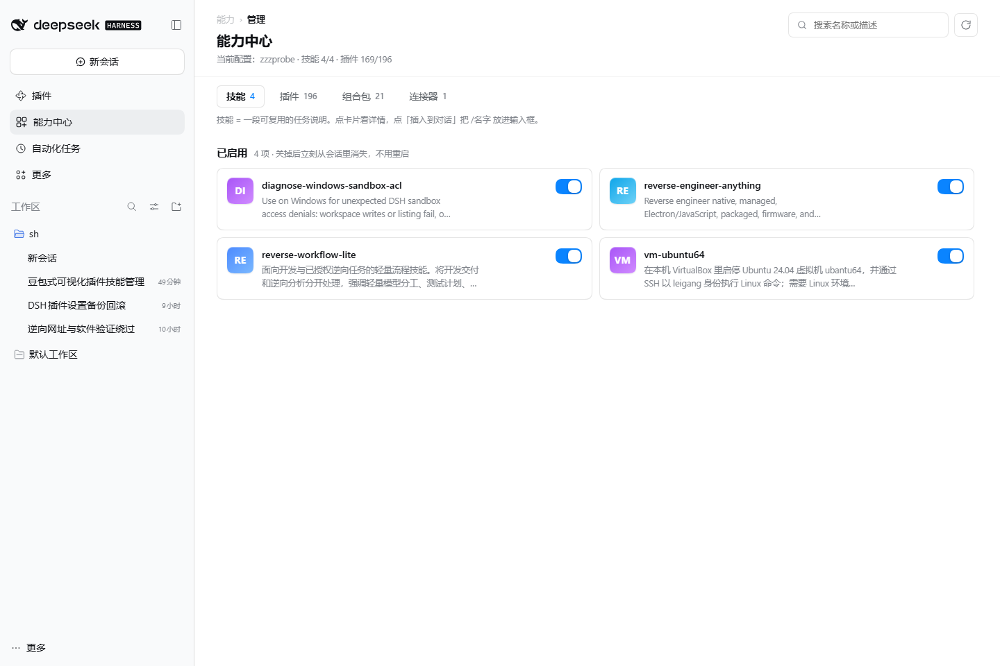
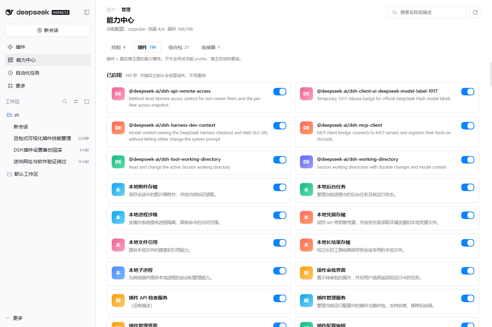
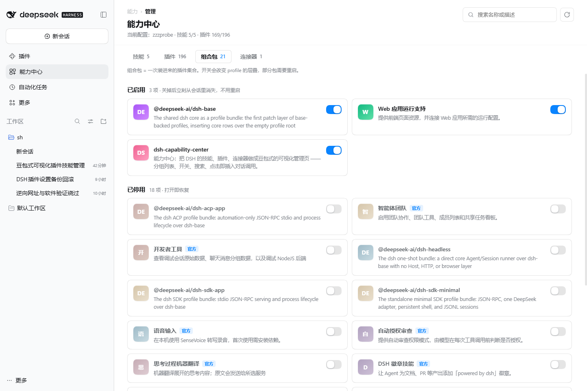
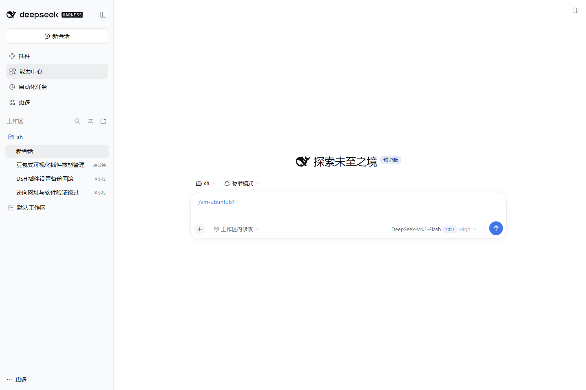
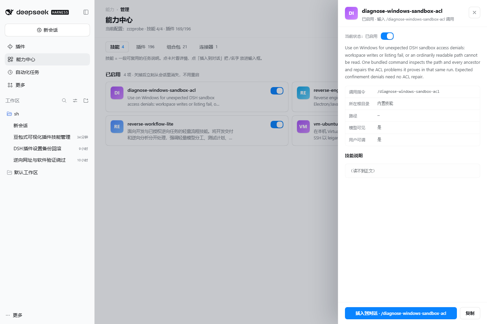

# 能力中心 · dsh-capability-center

[](https://github.com/niueigang/dsh-capability-center/releases)
[](https://github.com/niueigang/dsh-capability-center/actions/workflows/ci.yml)
[](LICENSE)
[](https://github.com/niueigang/dsh-capability-center)

给 [DeepSeek Harness](https://github.com/deepseek-ai/deepseek-harness) 加一个**豆包式的能力管理页**：
技能、插件、组合包、MCP 连接器放在同一页，分组卡片 + 右侧开关 + 搜索；
技能点开能读完整说明，点「插入到对话」直接把 `/技能名` 放进输入框 —— 回车就是一次调用。



装完之后侧栏多一项：

```
侧栏
 ├─ 插件              ← 宿主自带（组合包 / 实验性插件）
 ├─ 能力中心          ← 本插件
 └─ 自动化任务
```

---

## 一键安装

### 方式 A · 应用内（推荐，不用命令行）

1. 打开 DSH → 侧栏 **插件**
2. 右上角 **添加插件**
3. 粘贴仓库地址：

   ```
   https://github.com/niueigang/dsh-capability-center
   ```

4. 安装 → 启用 → 重启客户端

### 方式 B · PowerShell 一行

```powershell
irm https://raw.githubusercontent.com/niueigang/dsh-capability-center/main/install.ps1 | iex
```

想指定 profile 或版本：

```powershell
& ([scriptblock]::Create((irm https://raw.githubusercontent.com/niueigang/dsh-capability-center/main/install.ps1))) -Profile web -Ref v0.1.0
```

脚本只做三件事，都能手工还原：

1. 把源码放到 `%USERPROFILE%\.dsh\plugins\dsh-capability-center`
2. `profiles/<profile>/node_modules/dsh-capability-center` → 上一步的目录（junction，不需要管理员）
3. profile 的 `package.json` 里 `dependencies` 和 `dsh.profile.bundles` 各加一行

不碰 `app.asar`，不写注册表，不建计划任务。改 `package.json` 前会备份成 `package.json.bak-capcenter-<时间戳>`。

### 方式 C · 本地目录

```powershell
git clone https://github.com/niueigang/dsh-capability-center.git
node dsh-capability-center\tools\install.mjs desktop
```

装完**重启客户端**：新 bundle 要重新组一次 profile 的 loader 树才会挂上。

### 卸载

```powershell
node "%USERPROFILE%\.dsh\plugins\dsh-capability-center\tools\uninstall.mjs" desktop
```

---

## 四个页签

| 页签 | 内容 | 开关实际做了什么 |
| --- | --- | --- |
| **技能** | 用户技能、Agents 技能、内置技能全列出来；点开能读 `SKILL.md` 全文 | 在 `<root>/` ↔ `<root>/.disabled/` 之间搬目录，**立刻生效、不用重启** |
| **插件** | Loader 里每一行，带标题和描述 | `pluginManager.setPluginEnabled()`，写进 profile 的 `cordis.patch.yml`，宿主热重组 |
| **组合包** | 官方/第三方、版本、装没装 | `setBundleEnabled()`，改 profile 层叠；部分包要重启 |
| **连接器** | Loader 里的 MCP 行：传输方式 + 地址 | 同插件行，关掉即断开，下一次工具调用生效 |




### 技能开关为什么是「搬目录」

`dsh-skill-filesystem` 只扫根目录下一层（`<root>/<name>/SKILL.md` 或 `<root>/<name>.md`），
**刻意不支持嵌套** `**/SKILL.md`。所以把技能挪进 `<root>/.disabled/<name>/` 之后它就离开扫描面，
内容原封不动，随时能搬回来。文件监听器会立刻重扫，模型目录和 `/` 菜单同一秒就变。

内置技能、插件内置技能没有可搬的目录，开关是灰的，面板会写明原因。

### 开关被覆盖时会说实话

宿主可能返回 `application: "overridden"`（比如某一行是**用户级** `~/.dsh/cordis.patch.yml` 插进来的，
profile 再怎么写也压不过它）。此时面板提示「改动被更高层配置覆盖，实际没变」，不会假装成功。

---

## 点一下就能调用



技能详情页的「插入到对话」：

1. `ctx.layout.selectPanel(null)` 回到会话界面
2. 等 `[data-composer-input]` 出现，聚焦并把光标落到末尾
3. **等 240ms** 让 Lexical 把 DOM 选区同步进它自己的模型
   （不等这一步，`execCommand` 会返回 `true` 但一个字都插不进去）
4. `document.execCommand("insertText", false, "/技能名 ")`

插进去的 `/名字` 会被宿主的引用装饰器渲染成 chip，和手敲 `/` 选出来的一模一样。
第 4 步失败就退到剪贴板，并用一条挂在 `document.body` 上的全局提示条说明（面板此时已切走，页内 toast 会跟着消失）。



---

## 接口

面板背后只有一个前缀，注册在宿主 `webServer` 上，不碰别的路由：

| 方法 | 路径 | 作用 |
| --- | --- | --- |
| GET | `/capability/api/state` | 全量清单（技能/插件/组合包/连接器 + 计数） |
| POST | `/capability/api/toggle` | `{kind, id, enabled}` 开或关一条 |
| GET | `/capability/api/skill?id=…` | 某个技能的正文（含内置技能的兜底加载） |
| GET | `/capability/api/ping` | 健康检查 |

## 不会把宿主弄崩

- `inject` **一个服务都不写**。写进去的服务只要某版本没有，cordis 就停在 pending，宿主表现为卡死。
  所有服务（`webServer` / `pluginManager` / `skills` / `loader` / `profileContext`）全部软取，取不到就降级。
- 每段装配各自 `try/catch`，失败只记在运行时状态里，不抛给宿主。
- 不改 `app.asar`，不写注册表，不建计划任务。

## 开发

```bash
git clone https://github.com/niueigang/dsh-capability-center.git
cd dsh-capability-center
node test/smoke.mjs      # 宿主侧冒烟：临时 DSH_HOME，造 3 个技能，跑通开关/详情/错误分支
```

浏览器半侧没有构建步骤：`lib/client.js` 直接按宿主约定写 `window.__ModuleLoader__.load({id, factory})`，
用 `require("react")` 这类平台模块，改完刷新页面就走新代码。

## 目录

```
package.json        dsh.bundle.patch + dsh.client.platform=web
cordis.patch.yml    只 insert 自己这一行
lib/index.js        宿主侧 cordis 服务 + HTTP 路由
lib/api.js          接口分发
lib/state.js        技能/插件/组合包/连接器 → 一份清单
lib/skills.js       技能扫描、frontmatter 解析、开关搬运
lib/paths.js        DSH_HOME / profile 定位
lib/client.js       浏览器半侧：main 面板 + 侧栏入口（无构建）
install.ps1/.cmd    一键安装
tools/install.mjs   装进 profile（本地源码）
tools/uninstall.mjs 卸掉
tools/stamp.mjs     建仓时把 niueigang 换成真账号
tools/check-manifest.mjs  清单字段自检（CI 会跑）
test/smoke.mjs      宿主侧冒烟测试
```

## License

[MIT](LICENSE)
